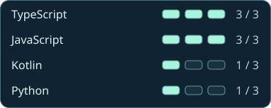

# Hi, I’m Pham Hoang Khang

**Aspiring software engineer · Full-stack web & Android**

I like building software around a concrete question. How does a route change when it crosses a steep slope? How should a screen-time app behave when a phone goes offline? Those questions shape what I build and what I test.

## Featured projects

### [Mars Navigator](https://github.com/SamKang5/VinSpace10)

Compare shortest and terrain-aware routes across the western fan of Jezero Crater, then follow one in a 3D expedition. VinSpace10 uses NASA and USGS terrain data for the NASA Space Apps Challenge 2026.

*React · TypeScript · Three.js · Vite* · [Try the route planner ↗](https://mars-navigator.pages.dev/)

### [Learn2Earn](https://github.com/SamKang5/Learn2Earn)

A family screen-time app for Android. Parents pair a device and assign quizzes. Children can earn extra time, and the device enforces its allowance even when it loses its connection.

*Kotlin · Android · Firebase · Cloudflare Pages Functions · D1*

### [ECONVERSE](https://github.com/SamKang5/ECONVERSE)

An economics learning platform where learners work through lessons and quizzes. Editors draft lesson updates, and staff review them before publication.

*React · TypeScript · Cloudflare Pages Functions · D1*

## Tech stack

**Web development**  
  

**Native mobile**  
 

**Backend and data**  
  

I’m currently learning about applied AI, data analytics, and application security.

## Languages across these projects

Each filled segment represents one featured repository where GitHub detected the language in November 2026.

[Browse all public repositories](https://github.com/SamKang5?tab=repositories)

## Contact

I’m open to collaborating on web, mobile, and education projects. [Find me on GitHub](https://github.com/SamKang5).
